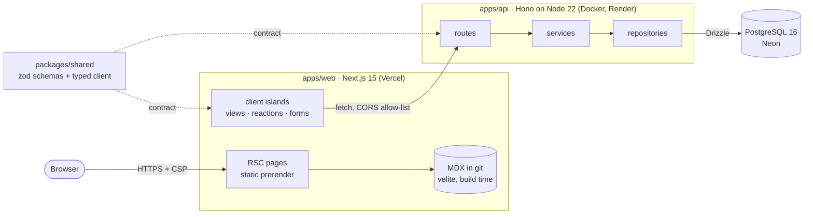

# devlog

[](https://github.com/Dude775/devlog/actions/workflows/ci.yml)
[](https://github.com/Dude775/devlog/actions/workflows/codeql.yml)
[](LICENSE)


Tech blog and project showcase by **David Rubin**, DevOps/Cloud engineer (AWS SAA).
The repository is a portfolio piece in its own right: a typed monorepo with a static-first Next.js
site, a layered Hono API on Postgres, shared runtime-validated contracts, hardened containers and a
CI pipeline that tests, scans and ships images.

<!-- Screenshot placeholder: capture the home page at 1440x900 (dark theme) and save it as
     docs/assets/home.png, then replace this comment with:
      -->

> **Screenshot:** _coming soon_ (home page, dark theme). Full case study:
> [system-portfolio.vercel.app](https://system-portfolio.vercel.app).

## Architecture



- **Static content never depends on the API.** Posts are compiled at build time; API-backed widgets
  render nothing if the API is down (verified by the E2E suite, which runs with the API offline).
- **One contract, two runtimes.** Every request/response is a zod schema in `@devlog/shared`, parsed
  by the API on input and by the client on output.
- **Privacy by construction.** Unique views use `HMAC-SHA256(salt, day|ip|ua)`; raw IPs are never
  stored or logged.

Details: [docs/ARCHITECTURE.md](docs/ARCHITECTURE.md) · Deployment: [docs/DEPLOYMENT.md](docs/DEPLOYMENT.md)

## Stack

| Layer     | Choice                                                                            |
| --------- | --------------------------------------------------------------------------------- |
| Monorepo  | pnpm 10 workspaces, Turborepo 2 (remote-cache ready, `turbo prune` for Docker)    |
| Web       | Next.js 15 App Router, React 19 RSC, Tailwind CSS v4, framer-motion, cmdk         |
| Content   | MDX + YAML via velite, shiki highlighting, Mermaid diagrams, RSS, sitemap, OG     |
| API       | Hono 4 on Node 22, Drizzle ORM, PostgreSQL 16, pino, zod                          |
| Contracts | `@devlog/shared`: zod schemas, inferred types, typed fetch client                 |
| Quality   | TypeScript strict (no `any`), ESLint 9 type-checked, Prettier, Vitest, Playwright |
| Security  | CSP/HSTS headers (web + api), rate limiting, CodeQL, Dependabot, non-root images  |
| Infra     | Multi-stage Docker images, docker compose, GHCR with SBOM + provenance            |
| Hosting   | Vercel (web), Render (api, Docker), Neon (Postgres)                               |

## Local development

Requires Node 22.12+, pnpm 10 (`corepack enable`) and Docker.

```bash
pnpm install
pnpm dev:setup   # creates apps/api/.env, starts Postgres in Docker, applies migrations
pnpm dev         # web http://localhost:3000 · api http://localhost:4000
```

| Command                                      | What it does                                                          |
| -------------------------------------------- | --------------------------------------------------------------------- |
| `pnpm lint` / `typecheck` / `test` / `build` | Turborepo pipeline across all workspaces                              |
| `pnpm test:e2e`                              | Builds web, runs Playwright smoke tests against the standalone server |
| `pnpm format`                                | Prettier (CI runs `format:check`)                                     |
| `TEST_DATABASE_URL=postgres://... pnpm test` | Adds Postgres integration tests for repositories                      |

Full stack in containers (postgres -> migrate -> api -> web):

```bash
cp infra/.env.example infra/.env   # set VIEW_HASH_SALT: openssl rand -hex 32
docker compose -f infra/docker-compose.yml --env-file infra/.env up --build
```

## Folder map

```
apps/
  web/                 Next.js site (@devlog/web)
    content/           posts/*.mdx, projects/*.yml (velite collections)
    src/app/           routes, SEO routes (sitemap, robots, rss.xml, OG images)
    src/components/    ui/ design system + feature components
    src/config/        site identity, categories, security headers
    e2e/               Playwright smoke tests
  api/                 Hono API (@devlog/api)
    src/routes/        HTTP only: validate, call service, shape response
    src/services/      business logic (no HTTP, no SQL)
    src/repositories/  Drizzle data access
    drizzle/           committed SQL migrations
packages/
  shared/              zod schemas + typed API client (runtime-agnostic)
  config/              ESLint flat config, tsconfig presets, Prettier
infra/                 Dockerfiles, docker-compose.yml
docs/                  ARCHITECTURE.md, DEPLOYMENT.md
.github/               CI, CodeQL, Dependabot
```

## CI/CD

| Workflow     | Jobs                                                                                                                                                                                       |
| ------------ | ------------------------------------------------------------------------------------------------------------------------------------------------------------------------------------------ |
| `ci.yml`     | format check -> per-app matrix lint/typecheck/test/build (Postgres service) · Playwright E2E -> Docker build; on `main`, push `devlog-web` and `devlog-api` to GHCR with SBOM + provenance |
| `codeql.yml` | CodeQL `security-extended` for TypeScript and GitHub Actions (PRs, `main`, weekly)                                                                                                         |
| Dependabot   | Weekly grouped updates for npm and GitHub Actions, respecting pinned majors                                                                                                                |

## Decisions

**Why a monorepo.** Web, API and their contract change together. One PR can add a zod schema, the
endpoint and the UI that consumes it, and CI type-checks all three at once, so a breaking API change
fails the build instead of production. Turborepo caches per package and `turbo prune` produces
minimal Docker build contexts, so the monorepo does not cost build time. Trade-off: one lockfile and
shared tooling versions, which is a feature at this scale.

**Why Hono.** The API is small, JSON-only and must be easy to test. Hono's `app.request()` runs the
full middleware stack in-process, so route tests use in-memory fakes with no network or database.
It is built on web-standard `Request`/`Response`, ships typed middleware (CORS, secure headers,
body limit, request id) without a plugin ecosystem to audit, and keeps the runtime portable
(Node today, edge or Bun later) with a tiny dependency surface. Express would need more glue;
NestJS would be more framework than problem.

**Why MDX in git.** Posts are code-reviewed, versioned and deployed like code, with no CMS to run,
pay for or secure. velite validates frontmatter against a schema at build time (a post that
references an unknown project fails the build), so content errors surface in CI. Pages are fully
static and CDN-cacheable; only engagement data (views, reactions, newsletter) is dynamic and lives
behind the API. Trade-off: publishing requires a commit, which is acceptable for a single author.

More conventions and rules: [CLAUDE.md](CLAUDE.md) · Roadmap: [PROGRESS.md](PROGRESS.md)

## License

[MIT](LICENSE) © David Rubin
