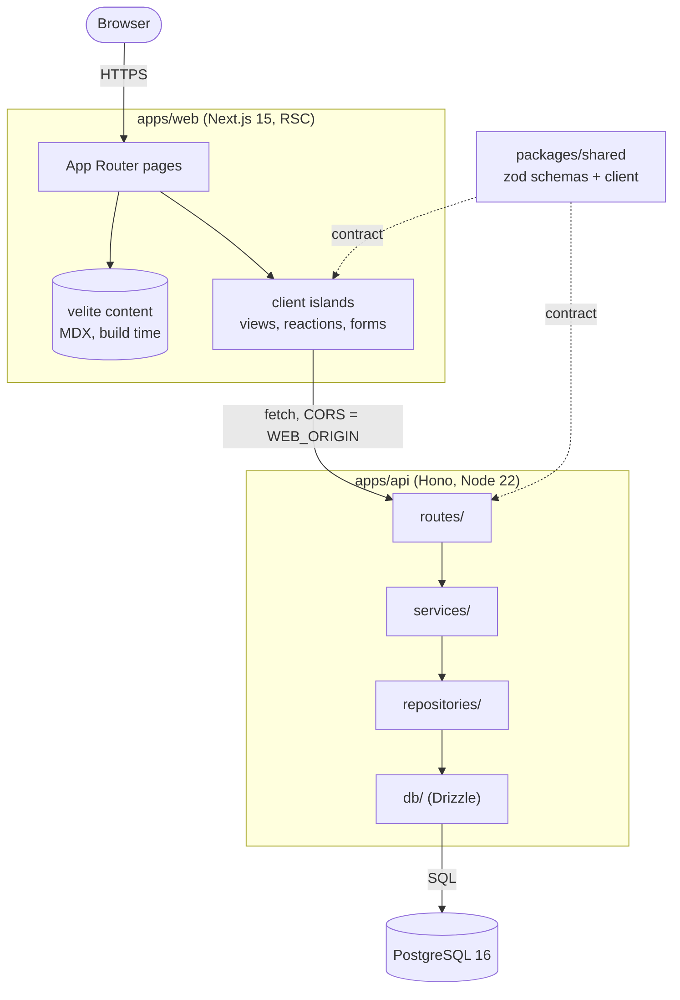

A personal blog is the smallest system that still has every production concern: content, a
public API, a database, deploys and observability. That makes it a good place to practice them
properly. This post walks through how the repo is split and the rules that keep it that way.

## The shape of the repo

Two apps and two packages, wired by pnpm workspaces and Turborepo:

```txt title="repo layout"
apps/web          Next.js 15 (App Router, RSC), MDX via velite
apps/api          Hono on Node 22, Drizzle ORM, PostgreSQL 16
packages/shared   zod schemas + typed API client
packages/config   ESLint flat config, tsconfig presets, Prettier
infra/            Dockerfiles + docker compose
```

## Runtime topology



Two kinds of data, two paths:

- **Static content** (posts, project cards) is compiled at build time by velite. No request
  ever needs the API to render an article.
- **Dynamic data** (views, reactions, newsletter, contact) goes through the API from small
  client islands. If the API is down, those widgets render nothing and the page still works.

## Rule 1: the web app never touches the database

`apps/web` has no database driver. Not "we try not to": there is no `postgres` or
`drizzle-orm` in its dependencies, so a shortcut does not even compile. All dynamic data goes
through `apps/api` using the typed client from `@devlog/shared`.

That gives the API a single job, owning the data, and makes it reusable by anything else later
(a CLI, a stats dashboard, another site).

## Rule 2: one contract, validated at both ends

Every request and response is a zod schema in `packages/shared`. Types are inferred, never
hand-written:

```ts title="packages/shared/src/schemas/engagement.ts"
export const postViewsResponseSchema = z.object({
  slug: slugSchema,
  count: z.number().int().nonnegative(),
});
export type PostViewsResponse = z.infer<typeof postViewsResponseSchema>;
```

The API parses input with the schema. The client parses the response with the same schema. A
breaking change in the contract fails `typecheck` in both apps in the same commit, which is the
main reason this is a monorepo and not three repos.

## Rule 3: API layers only call downward

```txt
routes/        HTTP only: parse input, call a service, shape the response
services/      business rules; no HTTP, no SQL
repositories/  data access via Drizzle; no business rules
db/            client, schema, migrations
```

`createApp()` is a pure composition root that receives its services. Production wiring happens
in `src/index.ts`; tests call `app.request()` with in-memory fakes. Route tests run in
milliseconds without a database, and a separate set of integration tests hits a real Postgres
in CI.

## Rule 4: privacy by construction

Unique views and reactions need visitor identity, but the API never stores or logs an IP.
Identity is `HMAC-SHA256(salt, day | ip | user-agent)`: stable for a day, useless after.

## The pipeline

CI runs a format check, then a matrix per app: lint, typecheck, test and build through
Turborepo with a restored cache. The `...` filter includes workspace dependencies, so changing
`packages/shared` re-verifies both apps.

```yaml title=".github/workflows/ci.yml"
- name: Lint, typecheck, test, build
  run: pnpm turbo run lint typecheck test build --filter=@devlog/${{ matrix.app }}...
```

Docker images are multi-stage, use `turbo prune` to ship only what each app needs, and run as a
non-root user. `docker compose up` starts Postgres, a one-shot migration job, the API and the
web app in dependency order.

## Trade-offs

- **More moving parts than a static site.** A blog does not _need_ an API. This one has one
  because the repo is also a portfolio piece, and because the API boundary is cheap to keep
  now and expensive to add later.
- **Monorepo tooling cost.** Turborepo, workspace protocols and pruned Docker builds add
  config. In exchange, cross-cutting changes are atomic and CI only rebuilds what changed.
- **Build-time content.** Publishing needs a deploy. For a blog that is a feature: every post
  goes through the same pipeline as code.

Next up: SEO plumbing (sitemap, RSS, JSON-LD, generated OG images), then hardening and an AWS
deployment with Terraform.
