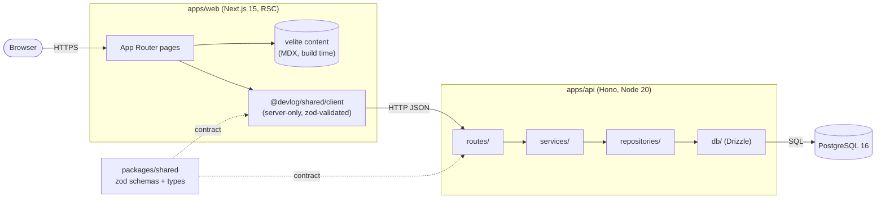
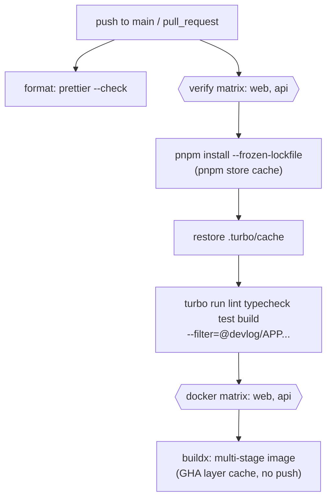

# Architecture

## Runtime topology

### Boundaries

| Rule                                                    | Why                                                |
| ------------------------------------------------------- | -------------------------------------------------- |
| Web has no DB driver; all dynamic data via the API      | Single owner of data, API is reusable and testable |
| API layers only call downward                           | Swap storage or transport without touching logic   |
| Request/response shapes are zod schemas in `shared`     | One contract, validated at both ends at runtime    |
| `createApp()` is pure; wiring happens in `src/index.ts` | HTTP tests run in-process with fakes, no DB needed |
| Env parsed once by zod at startup                       | Fail fast on misconfiguration                      |

### Health endpoints

| Endpoint            | Purpose   | Behaviour                                                  |
| ------------------- | --------- | ---------------------------------------------------------- |
| `GET /health`       | Liveness  | Always 200 `{ status: "ok", version, uptime }`; no DB call |
| `GET /health/ready` | Readiness | 200 when `select 1` succeeds, else 503 `not_ready`         |

## CI/CD flow

## Container images

Both Dockerfiles follow the same pattern:

1. `pruner`: `turbo prune <app> --docker` emits only the app's workspace graph and a pruned lockfile.
2. `builder`: install from `out/json` (cache-friendly layer), copy `out/full`, `turbo build`.
3. `runner`: clean `node:20-alpine`, runs as `node` (uid 1000), `HEALTHCHECK` built in.
   - web: Next.js `output: "standalone"` (no `node_modules` install).
   - api: `pnpm deploy --prod` (production deps only) + tsup bundle with `@devlog/*` inlined.

Compose runs `postgres -> api -> web` gated on `service_healthy`, binds ports to `127.0.0.1` only, and sets `no-new-privileges` (api is also `read_only`).
