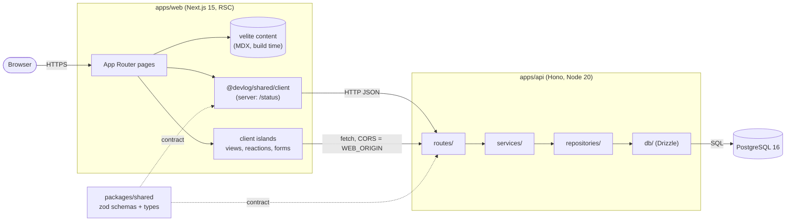
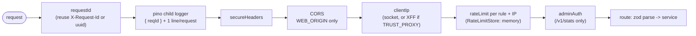
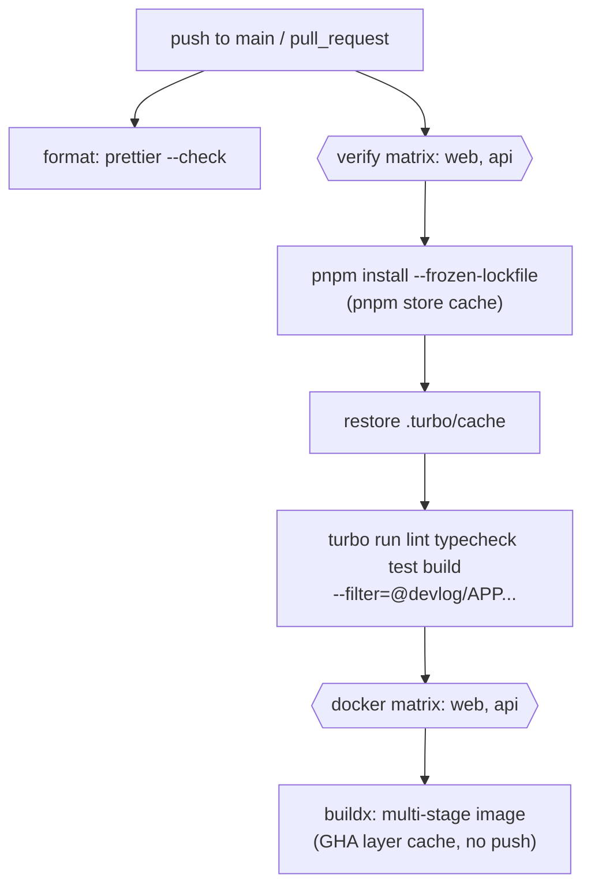

# Architecture

## Runtime topology

### Boundaries

| Rule                                                    | Why                                                |
| ------------------------------------------------------- | -------------------------------------------------- |
| Web has no DB driver; all dynamic data via the API      | Single owner of data, API is reusable and testable |
| API layers only call downward                           | Swap storage or transport without touching logic   |
| Request/response shapes are zod schemas in `shared`     | One contract, validated at both ends at runtime    |
| `createApp()` is pure; wiring happens in `src/index.ts` | HTTP tests run in-process with fakes, no DB needed |
| Env parsed once by zod at startup                       | Fail fast on misconfiguration                      |
| Interactive widgets call the API from the browser       | API sees the real client for rate limits and dedup |
| Widgets render nothing when the API fails               | Static content never depends on API availability   |

### Health endpoints

| Endpoint            | Purpose   | Behaviour                                                  |
| ------------------- | --------- | ---------------------------------------------------------- |
| `GET /health`       | Liveness  | Always 200 `{ status: "ok", version, uptime }`; no DB call |
| `GET /health/ready` | Readiness | 200 when `select 1` succeeds, else 503 `not_ready`         |

### v1 endpoints

| Endpoint                   | Behaviour                                                                     |
| -------------------------- | ----------------------------------------------------------------------------- |
| `GET /v1/views/:slug`      | `{ slug, count }`                                                             |
| `POST /v1/views/:slug`     | Records a unique view (per visitor per UTC day), returns `{ slug, count }`    |
| `GET /v1/reactions/:slug`  | `{ slug, counts: { fire, brain, rocket } }` (zero-filled)                     |
| `POST /v1/reactions/:slug` | Body `{ type }`; each type counts once per visitor per day; returns counts    |
| `POST /v1/subscribe`       | Body `{ email, website? }`; 202 `{ status: "pending" }` (new, dup or spam)    |
| `POST /v1/contact`         | Body `{ name, email, message, website? }`; 202 `{ status: "received" }`       |
| `GET /v1/stats`            | Requires `x-admin-api-key: $ADMIN_API_KEY`; totals, top posts, subscriber/msg |

Errors are always `{ error: { code, message } }` with codes `bad_request`, `validation_error`,
`unauthorized`, `not_found`, `payload_too_large` (16 KB body cap), `rate_limited`, `internal`.

### Request pipeline

Rate-limit rules (fixed window, per IP): `read` 120/min, `engage` 30/min, `inbox` 5/15 min,
`admin` 20/min. `RateLimitStore` is an interface; swap the in-memory store for Redis when running
more than one instance.

### Privacy: unique views without storing IPs

`visitor_hash = HMAC-SHA256(VIEW_HASH_SALT, day | ip | user-agent)`. Keyed, because an unkeyed
hash of the IPv4 space is trivially brute-forced. The day is part of the input, so identifiers
rotate every UTC day and cannot be joined across days. Only the hash and the day are stored
(`post_view_visitors`, `reaction_visitors`); counts live in `post_views` / `reactions`. The raw IP
exists only in request memory and is never logged (the logger also redacts emails and the admin key).

### Spam protection

Zod limits on every field, a 16 KB body cap, per-IP rate limits and a honeypot `website` field.
Honeypot hits and duplicate subscriptions get the same 202 as real ones (no signal for bots, no
email enumeration).

### Migrations

`drizzle-kit generate` writes SQL to `apps/api/drizzle/`. `src/migrate.ts` (bundled to
`dist/migrate.js`) applies it. Compose runs it as a one-shot `migrate` service; `api` waits for
`service_completed_successfully`.

## CI/CD flow

## Container images

Both Dockerfiles follow the same pattern:

1. `pruner`: `turbo prune <app> --docker` emits only the app's workspace graph and a pruned lockfile.
2. `builder`: install from `out/json` (cache-friendly layer), copy `out/full`, `turbo build`.
3. `runner`: clean `node:20-alpine`, runs as `node` (uid 1000), `HEALTHCHECK` built in.
   - web: Next.js `output: "standalone"` (no `node_modules` install).
   - api: `pnpm deploy --prod` (production deps only) + tsup bundle with `@devlog/*` inlined.

Compose runs `postgres -> migrate -> api -> web` gated on `service_healthy` / `service_completed_successfully`, binds ports to `127.0.0.1` only, and sets `no-new-privileges` (api is also `read_only`).
