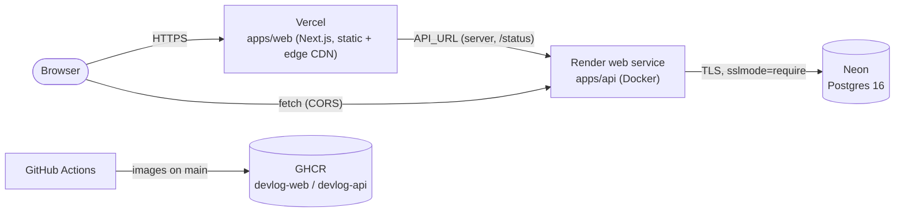

# Deployment

Production topology: **web on Vercel**, **api on Render (Docker)**, **Postgres on Neon**.
Container images are also published to GHCR on every push to `main` for any other Docker host.



Deploy order matters because each side needs the other's URL: **Neon -> migrations -> Render -> Vercel -> CORS update**.

## 0. Prerequisites

- GitHub repo `Dude775/devlog` with CI green on `main`.
- Accounts: Neon, Render, Vercel (each connected to GitHub).
- Two secrets, generated once and stored in a password manager:

```bash
openssl rand -hex 32   # VIEW_HASH_SALT
openssl rand -hex 32   # ADMIN_API_KEY (optional, enables GET /v1/stats)
```

Pick the names now so URLs are known in advance:

| Thing          | Example value                                                   |
| -------------- | --------------------------------------------------------------- |
| Vercel project | `devlog` -> `https://devlog.vercel.app` (or your custom domain) |
| Render service | `devlog-api` -> `https://devlog-api.onrender.com`               |

If a name is taken, the platform appends a suffix; use the real URL everywhere below.

## 1. Postgres on Neon

1. Neon console -> **New Project**: name `devlog`, Postgres version **16**, region close to the Render
   region you will pick (e.g. AWS `us-east-2` with Render Ohio, AWS `eu-central-1` with Render Frankfurt).
2. Database name `devlog` (or keep `neondb`), keep the default owner role.
3. **Connect** dialog -> turn **Connection pooling off** and copy the **direct** connection string:
   `postgresql://<role>:<password>@<endpoint>.<region>.aws.neon.tech/devlog?sslmode=require`.
   The api is one long-lived process with a pool of 10 (`src/db/client.ts`), so the pooler adds nothing.
4. Apply migrations from your machine (idempotent; Drizzle tracks applied files):

```bash
pnpm install
DATABASE_URL='postgresql://...neon.tech/devlog?sslmode=require' pnpm --filter @devlog/api db:migrate
```

Expected log: `migrations applied`. Re-run this after every merge that adds a file to `apps/api/drizzle/`
unless the Render pre-deploy command (step 2) does it for you.

## 2. API on Render (Docker)

1. Render dashboard -> **New -> Web Service** -> connect `Dude775/devlog`.
2. Settings:

| Field                | Value                                                       |
| -------------------- | ----------------------------------------------------------- |
| Name                 | `devlog-api`                                                |
| Language / Runtime   | **Docker**                                                  |
| Branch               | `main`                                                      |
| Region               | same as Neon                                                |
| Root Directory       | _(empty: repo root)_                                        |
| Dockerfile Path      | `infra/docker/api.Dockerfile`                               |
| Docker Build Context | `.`                                                         |
| Health Check Path    | `/health/ready` (fails with 503 when the DB is unreachable) |
| Pre-Deploy Command   | `node dist/migrate.js` (paid instance types only, see note) |
| Auto-Deploy          | On; choose "after CI checks pass" if your plan offers it    |

3. Environment variables: see [api env table](#api-render). Do **not** set `PORT`: Render injects it and
   the api reads it.
4. **Create Web Service**. First build takes a few minutes (turbo prune + pnpm install).
5. Verify:

```bash
curl -s https://devlog-api.onrender.com/health        # {"status":"ok","version":...}
curl -s https://devlog-api.onrender.com/health/ready  # {"status":"ready",...}; 503 means DATABASE_URL/Neon issue
curl -sI https://devlog-api.onrender.com/health | grep -iE 'content-security|strict-transport'
```

Notes:

- **Free instance type:** no pre-deploy command, so run migrations manually (step 1.4) before merging
  a migration. Free services also sleep after ~15 min idle; the first request then takes up to a minute.
  The site does not break: view counts and reactions simply do not render until the api answers.
- **Rate limiting** uses an in-memory store, correct for exactly **one** instance. Do not scale out
  horizontally before adding the Redis `RateLimitStore` (PROGRESS backlog).
- **`TRUST_PROXY=true`** makes the api read the client IP from the left-most `X-Forwarded-For` entry.
  That is required behind Render's proxy, but the left-most entry is only trustworthy if the proxy
  overwrites the header; treat per-IP limits as best effort, not as an auth boundary.
- **Alternative: deploy the GHCR image** instead of building on Render. Create the service from
  **Existing Image** `ghcr.io/dude775/devlog-api:latest` (or a pinned `:<git-sha>` tag). GHCR packages are
  private by default: either make the package public (GitHub -> Packages -> devlog-api -> Package settings)
  or add a Render registry credential with a GitHub PAT that has `read:packages`.

## 3. Web on Vercel

1. Vercel dashboard -> **Add New -> Project** -> import `Dude775/devlog`.
2. Settings:

| Field            | Value                                                                           |
| ---------------- | ------------------------------------------------------------------------------- |
| Project Name     | `devlog`                                                                        |
| Framework Preset | **Next.js**                                                                     |
| Root Directory   | `apps/web` (keep "Include files outside the root directory" enabled)            |
| Install Command  | default (Vercel detects pnpm from the root `pnpm-lock.yaml` + `packageManager`) |
| Build Command    | default `next build` (velite runs inside `next.config.ts`)                      |
| Output           | default (`.next`)                                                               |
| Node.js Version  | 22.x (`engines.node` is `>=22.12`)                                              |

3. Environment variables: see [web env table](#web-vercel). Set them for **Production** before the first
   deploy: `NEXT_PUBLIC_*` values are inlined at build time, so changing them requires a redeploy.
4. **Deploy**, then (optional) **Settings -> Domains** to add a custom domain. If you do, update
   `NEXT_PUBLIC_SITE_URL` and redeploy (canonical URLs, sitemap, RSS, OG and JSON-LD use it).
5. Optional: **Settings -> Git -> Ignored Build Step** = `npx turbo-ignore @devlog/web` to skip deploys
   when only the api changed.

## 4. Close the loop (CORS)

1. Render -> `devlog-api` -> Environment: set `WEB_ORIGIN` to the exact production origin(s), no trailing
   slash, comma-separated: `https://devlog.vercel.app,https://your-domain.com`. Save (Render redeploys).
2. Verify from a shell:

```bash
curl -si -X OPTIONS https://devlog-api.onrender.com/v1/views/x \
  -H 'origin: https://devlog.vercel.app' -H 'access-control-request-method: POST' \
  | grep -i access-control-allow-origin
```

3. Open a post on the live site: the view counter appears and reactions work. Vercel **preview**
   deployments have other origins; their widgets render nothing unless you add those origins too.

## Environment variables

### Web (Vercel)

| Variable               | Required | Scope           | Example                           | Purpose                                                                                            |
| ---------------------- | -------- | --------------- | --------------------------------- | -------------------------------------------------------------------------------------------------- |
| `NEXT_PUBLIC_SITE_URL` | yes      | build (inlined) | `https://devlog.vercel.app`       | Canonical URL for metadata, sitemap, RSS, OG, JSON-LD; `https` enables `upgrade-insecure-requests` |
| `NEXT_PUBLIC_API_URL`  | yes      | build (inlined) | `https://devlog-api.onrender.com` | Browser calls (views, reactions, forms); its origin is added to CSP `connect-src`                  |
| `API_URL`              | yes      | server runtime  | `https://devlog-api.onrender.com` | Server-side calls (`/status`)                                                                      |

### API (Render)

| Variable         | Required      | Example                                            | Purpose                                                                         |
| ---------------- | ------------- | -------------------------------------------------- | ------------------------------------------------------------------------------- |
| `NODE_ENV`       | yes           | `production`                                       | Enables production checks (e.g. `VIEW_HASH_SALT` required)                      |
| `DATABASE_URL`   | yes           | `postgresql://...neon.tech/devlog?sslmode=require` | Neon **direct** connection string                                               |
| `WEB_ORIGIN`     | yes           | `https://devlog.vercel.app`                        | CORS allow-list, comma-separated exact origins                                  |
| `VIEW_HASH_SALT` | yes           | 64 hex chars                                       | HMAC key for visitor hashes; min 32 chars; rotating it resets daily dedup only  |
| `TRUST_PROXY`    | yes on Render | `true`                                             | Read client IP from `X-Forwarded-For` (behind Render's proxy)                   |
| `ADMIN_API_KEY`  | no            | 64 hex chars                                       | Enables `GET /v1/stats` (`x-admin-api-key` header); unset = endpoint always 401 |
| `LOG_LEVEL`      | no            | `info`                                             | pino level                                                                      |
| `PORT`           | no (injected) | `10000`                                            | Set by Render; default 4000 elsewhere                                           |
| `HOST`           | no            | `0.0.0.0`                                          | Bind address (default is correct for containers)                                |

### CI (GitHub repository settings, optional)

| Variable (Actions -> Variables) | Purpose                                                                      |
| ------------------------------- | ---------------------------------------------------------------------------- |
| `NEXT_PUBLIC_SITE_URL`          | Baked into the `devlog-web` GHCR image (defaults to `http://localhost:3000`) |
| `NEXT_PUBLIC_API_URL`           | Baked into the `devlog-web` GHCR image (defaults to `http://localhost:4000`) |

Pushing to GHCR uses the built-in `GITHUB_TOKEN` (`packages: write` on the docker job); no secret to add.

## Security headers

| App | Where                                                                      | Headers                                                                                                                                          |
| --- | -------------------------------------------------------------------------- | ------------------------------------------------------------------------------------------------------------------------------------------------ |
| web | `apps/web/src/config/security-headers.ts` via `next.config.ts` `headers()` | CSP, HSTS (2y, preload), `X-Content-Type-Options`, `X-Frame-Options: DENY`, `Referrer-Policy`, `Permissions-Policy`, COOP, no `X-Powered-By`     |
| api | `apps/api/src/app.ts` (`secureHeaders`)                                    | CSP `default-src 'none'`, HSTS, `nosniff`, `X-Frame-Options: DENY`, `Referrer-Policy: no-referrer`, `Permissions-Policy`, CORP/COOP/OAC defaults |

CSP trade-off on the web: pages are statically prerendered, so there is no per-request nonce.
`script-src` allows `'self'` plus `'unsafe-inline'` for the Next.js/next-themes bootstrap; injection
risk is bounded because all content is authored MDX in git (no user HTML is rendered), `object-src`,
`base-uri`, `form-action` and `frame-ancestors` are locked down, and `connect-src` only allows the api
origin. Moving to nonces (middleware + dynamic rendering) is possible but costs the CDN-static model.
The Playwright smoke suite fails on any CSP violation, so a header change that breaks hydration or
Mermaid is caught in CI.

Check production with `curl -sI https://devlog.vercel.app | grep -i content-security` or
<https://securityheaders.com>. Submit the domain to <https://hstspreload.org> only once every subdomain
serves HTTPS (the header already carries `preload`).

## Images on GHCR

On every push to `main`, after `verify` and `e2e` pass, CI publishes:

| Image                        | Tags                     | Extras                |
| ---------------------------- | ------------------------ | --------------------- |
| `ghcr.io/dude775/devlog-api` | `latest`, `sha-<40 hex>` | SBOM + max provenance |
| `ghcr.io/dude775/devlog-web` | `latest`, `sha-<40 hex>` | SBOM + max provenance |

Deploy by immutable `sha-` tag; use `latest` only for local trials. Run the same api image for
migrations: `docker run --rm -e DATABASE_URL=... ghcr.io/dude775/devlog-api:sha-<sha> node dist/migrate.js`.

## Rollback

| Layer  | How                                                                                                              |
| ------ | ---------------------------------------------------------------------------------------------------------------- |
| web    | Vercel -> Deployments -> previous deployment -> **Promote to Production** (instant)                              |
| api    | Render -> Events -> previous deploy -> **Rollback**, or redeploy a previous GHCR `sha-` tag                      |
| schema | Migrations are forward-only; ship a new migration. Neon **branches / point-in-time restore** cover data recovery |
